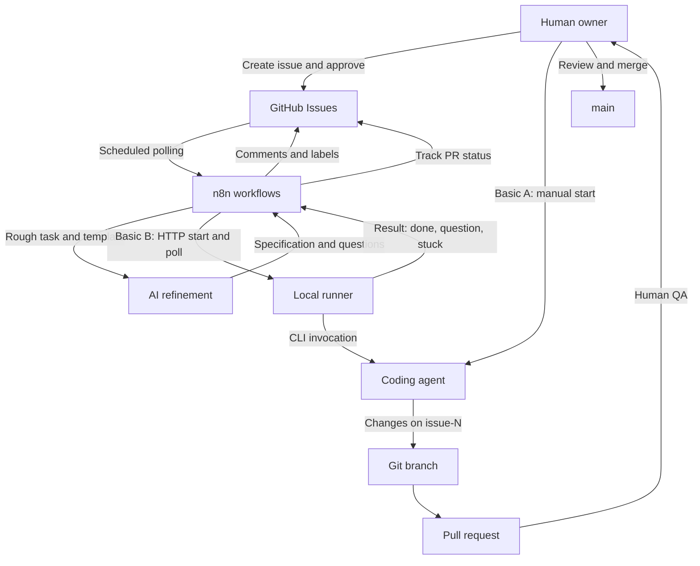

# Architecture — proposed design

## State transitions

| State | Actor and behavior |
|---|---|
| Ideas | Owner creates rough issue |
| Refining | n8n runs refinement |
| Ready for approval | n8n posts proposed spec; owner can comment for another refinement |
| Approved | Owner explicitly approves; in Basic B n8n may resume an already-approved task after an authenticated owner reply |
| Building | n8n claims one approved task; agent uses issue-N branch |
| Waiting for you | Basic B posts agent question and waits for owner reply |
| Stuck | Basic B records failure or timeout over 30 minutes; owner retries or closes |
| Your QA | n8n detects/open PR; owner reviews, closes, merges or explicitly requests rework |
| Done | n8n detects merge or issue closure |

## Proposed implementation

Basic A: three scheduled n8n workflows: refine tasks, start tasks, track PRs. Basic B: add result collection and a Python HTTP runner with a single active job, 30-minute timeout and structured results. The runner responds promptly to start requests; n8n polls for completion. In Docker, use host.docker.internal if supported/configured, not localhost, for host access.

Security requirements: validate repository and owner identity, treat issue content as untrusted, use minimal token scopes, prevent concurrent claims, never auto-merge, keep secrets outside Git, and require independent code-change and test checks for Advanced. Flag changes to tests and .github for human review. Container isolation and network restrictions must be tested before claiming they work.

This is a design, not a verified deployment. Agent provider and exact implementation details are to be confirmed by the project owner.
